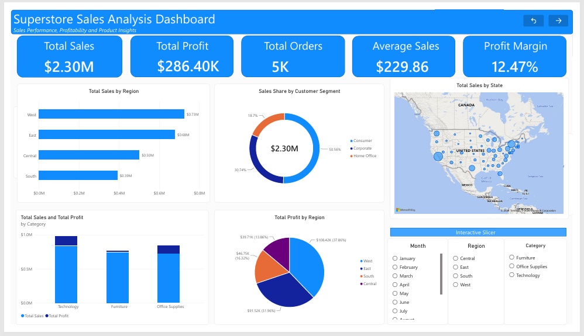
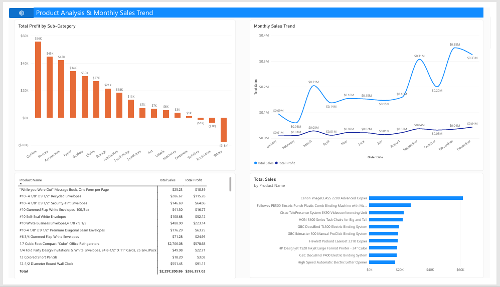

# Superstore Sales Analysis Dashboard | Power BI

## Project Overview

This project was completed as part of the **AnalystLab Africa Experience Lab Internship Programme — Week 2**. It focuses on analysing the Superstore Sales Dataset using Microsoft Power BI to understand sales performance, profitability, customer segments, regional trends, and product performance.

The goal was to transform raw sales data into an interactive dashboard that presents meaningful insights and supports data-driven business decisions.

## Tools and Technologies

- **Microsoft Power BI Desktop** — data visualization and dashboard development
- **Power Query** — data cleaning and transformation
- **DAX** — calculated measures and key performance indicators (KPIs)
- **Superstore Sales Dataset** — data source

## Dashboard Preview

### Page 1: Executive Sales Dashboard

This page provides an overview of business performance through key performance indicators, regional sales, category performance, customer segments, and monthly sales trends.

### Page 2: Product Analysis

This page explores product-level sales and profitability, highlighting high-performing products and products that may require further review.

## Key Performance Indicators

| Metric | Result |
|---|---:|
| Total Sales | $2,297,200.86 |
| Total Profit | $286,397.02 |
| Total Orders | 5,009 |
| Average Sales | $229.86 |
| Profit Margin | 12.47% |

## Key Business Insights

1. **Regional performance:** The West region recorded the highest sales and profit, followed by the East region.
2. **Customer segments:** The Consumer segment contributed approximately 50.56% of total sales, making it the largest customer segment.
3. **Category performance:** Technology generated the highest sales and profit among the three product categories.
4. **Product profitability:** Copiers, Phones, and Accessories were among the strongest sub-categories by profit.
5. **Areas of concern:** Tables, Bookcases, and Supplies recorded losses, indicating a need to review pricing, costs, discounts, and product performance.

## Business Recommendations

- Review pricing, discounting, and cost structures for loss-making products.
- Investigate opportunities to improve sales and profitability in the Central and South regions.
- Continue to support profitable Technology and Office Supplies products.
- Develop strategies to grow the Corporate and Home Office segments while retaining Consumer customers.
- Monitor product profitability regularly to identify emerging risks and opportunities.

## Skills Demonstrated

- Data cleaning and transformation
- Data modelling and DAX measures
- KPI development
- Interactive dashboard design
- Data visualization
- Business insight generation
- Data-driven recommendations

## Project Files

- **Power BI report:** `Superstore_Sales_Analysis.pbix` (if included in this repository)

## Acknowledgements

This project was completed as part of the **AnalystLab Africa Experience Lab Internship Programme**. The project provided an opportunity to practise transforming sales data into insights using Power BI.
